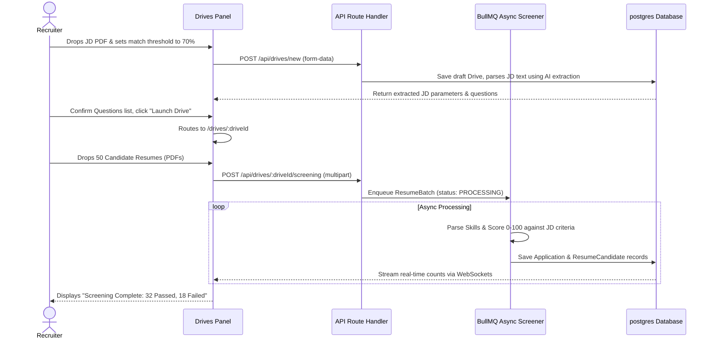
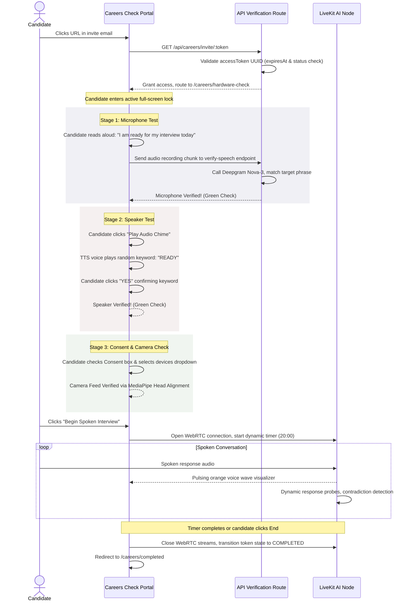

# Document 03 — App Flow & Navigation Map

## Sreevaai · AI Interview & Recruitment Automation Platform

This document defines the complete visual structure, entry points, authentication boundaries, and state transitions for both the **Recruiter Admin Portal** (including SuperAdmin views) and the **Candidate Experience Portal** of Sreevaai.

---

## 01 · System Architecture & Boundaries

Sreevaai segregates users into three clear semantic roles, each accessing distinct routing domains:
1. **SUPER_ADMIN (Platform Operator):** Accesses `/super-admin/*` routes to manage active organizations, review billing quotas, and adjust systemic voice catalogs.
2. **ADMIN (Recruiter / HR Admin):** Accesses `/dashboard`, `/drives`, `/assistant`, and `/billing`. This role represents all normalized organization-level roles (`ORG_ADMIN`, `HR`, `TEAM`). Secured by an `httpOnly` JWT session cookie.
3. **CANDIDATE (Job Applicant):** Accesses secure, passwordless `/careers/*` routes using a unique cryptographic UUID `accessToken` in the URL parameter.

```mermaid
graph TD
    A[Brand Visitor] -->|Landing /| B(Marketing Site)
    B -->|Click Try Free / Signup| C{Auth Guard}
    C -->|SUPER_ADMIN| D[/super-admin/dashboard]
    C -->|ADMIN / Recruiter| E[/auth/login]
    
    subgraph Recruiter / Admin Portal
    E --> F[/onboarding]
    E --> G[/dashboard]
    F --> G
    G --> H[/drives]
    G --> I[/assistant]
    G --> J[/billing]
    H -->|Create| K[/drives/new]
    H -->|Drive Dashboard| L[/drives/:driveId]
    L -->|Screening Queue| M[/drives/:driveId/screening]
    L -->|Candidate Detail| N[/drives/:driveId/candidates/:candidateId]
    end
    
    subgraph Candidate Portal
    O[Email Link /careers/invite/:token] -->|Access Check| P[/careers/welcome]
    P -->|Hardware Consent| Q[/careers/hardware-check]
    Q -->|Calibrated & Verified| R[/careers/session]
    R -->|Timer/Submit| S[/careers/completed]
    end
```

---

## 02 · Pages List & Routes Map

### A. Marketing & Public Pages
*   `/` — Sreevaai Landing Page. High-fidelity product details, proctoring showcase, pricing matrices, and call-to-actions.
*   `/auth/login` — Normalizes login. Checks `SuperAdmin` first, then `User` table. Implements Redis sliding window rate limits (5 attempts/60s).
*   `/auth/signup` — Direct corporate signup, transitioning to onboarding.
*   `/auth/forgot-password` — Password reset initiation page. Triggers a 6-digit OTP to corporate email.

### B. Recruiter / HR Admin Portal (Admin Role Only)
*   `/onboarding` — Organization wizard. Sets custom slug, default Cartesia voice, industry, and selects base plan.
*   `/dashboard` — Recruiter metrics panel. Completed counts (142), avg score (74%), candidate funnel chart, and active real-time feed.
*   `/drives` — Main drives board. Grid listing active, draft, and archived job campaigns.
*   `/drives/new` — Drive creation wizard. Uploads JD PDF, defines minimum screening threshold (0-100), and auto-generates AI interview questions.
*   `/drives/:driveId` — Drive dashboard. Features tab filters for candidates, resume screening batch statuses, and drive configurations.
*   `/drives/:driveId/candidates/:candidateId` — Candidate Dossier. Visualizes evaluation score dials, interactive timeline of 20 proctoring signals, full transcript blocks, and the strategic verdict.
*   `/assistant` — Recruiter AI Chat Assistant. Consists of a full-screen conversational interface querying organizational candidate details.
*   `/billing` — Usage meters displaying total interviews consumed against purchased quotas.

### C. Candidate Experience Portal (CANDIDATE Role / Token Access Only)
*   `/careers/invite/:token` — Validates candidate `accessToken` status (`PENDING` or `IN_PROGRESS`). If expired, routes to `/careers/expired`. If valid, sets token state to active and routes to welcome.
*   `/careers/welcome` — Candidate instructions screen showing job details, 20-minute spoken limit rules, and a device consent notice.
*   `/careers/hardware-check` — Multi-stage diagnostic environment screen, matching the React interface.
*   `/careers/session` — Focused fullscreen live WebRTC audio interview with "Ishitha". Displays dynamic voice waves, countdown timer, and in-frame head tracking.
*   `/careers/completed` — Calm visual confirmation page. Displays checkmarks for verification checks, session completion, and data sync.

---

## 03 · Navigation Structure & Layout

### 1. Recruiter Dashboard Grid Layout
```
[Top Global Control Strip]
├── Sreevaai Brand Logo (Click → /dashboard)
├── Active Organization Selector (Dropdown)
├── System Quota Quick-Pill (Flashes Orange upgrade warning if Quota is depleted)
└── User Avatar Dropdown
      ├── Edit Profile & OTP Security
      ├── Quota & Billing (/billing)
      └── Sign Out (Blacklists JWT token in Redis)

[Left-Side Persistent Side-Drawer]
├── 📊 Dashboard           --> Redirects to `/dashboard`
├── 💼 Hiring Drives        --> Redirects to `/drives`
├── 💬 AI Assistant        --> Redirects to `/assistant`
└── 💳 Plan & Billing      --> Redirects to `/billing`
```

### 2. Candidate Fullscreen Experience
*   **Navigation Restrictions:** Side drawers and top bars are completely hidden. Exiting fullscreen mode, opening developer tools, or switching browser tabs triggers the **Proctoring Alert Modal** which freezes session progress.
*   **Mobile Gating:** When `/careers/invite/:token` detects a mobile browser agent, it blocks entry and displays a centered visual overlay: "Mobile device detected. Please open this link on Google Chrome or Microsoft Edge on a desktop to complete your environment check."

---

## 04 · Entry Points & Onboarding Flow Sequence

### 1. Recruiter Registration Pipeline
```
[User lands on `/`]
  └── Clicks "Start Hiring Free"
        └── Navigates to `/auth/signup`
              └── Inputs corporate email & password
                    └── Navigates to `/onboarding`
                          ├── Enters Org Name & Slug
                          ├── Chooses default voice; LLM is fixed in code
                          └── Completes setup
                                └── Redirected to `/dashboard` (Role: ADMIN)
```

### 2. Password Reset OTP Sequence
```
[Recruiter clicks "Forgot Password" on `/auth/login`]
  └── Navigates to `/auth/forgot-password`
        └── Inputs email -> Triggers 6-digit OTP code via Resend
              └── Redirected to `/auth/verify-otp`
                    └── Enters OTP -> Moves to `/auth/reset-password`
                          └── Updates bcrypt password
                                └── Redis sets `auth:pwd_change:<userId>`
                                      └── System invalidates all active session cookies
```

---

## 05 · Core User Journeys

### Journey 1: Recruiter JD Auto-Parsing & Resume Screening Pipeline



### Journey 2: Candidate Multi-Stage Diagnostics & Live Interview Session



---

## 06 · Overlay, Drawer & Modal Interactions

### 1. Profile Security Slide-Out Drawer (Admin Portal)
*   **Trigger:** Clicked "Profile Settings" in user avatar dropdown.
*   **Transition:** Drawer slides out from the right margin over a darkened backdrop.
*   **Operations:** Features an OTP-gated security console. Changing profile parameters or password triggers `POST /api/auth/otp/send`, requiring the Recruiter to enter their 6-digit email confirmation code before updates are committed.

### 2. Quota Depleted Warning Modal (Admin Portal)
*   **Trigger:** Recruiter enters `/drives/:driveId` when `Organization.status` equals `QUOTA_EXCEEDED`.
*   **UX Execution:** Lockout modal overlay disables main pipeline controls. Shows diagnostic text: "Hiring limits exceeded. 0 of 100 interviews remaining in your monthly billing cycle." Action button `[ View Plans & Upgrade ]` routes directly to the Billing screen.

### 3. Proctoring Exit Modal Alert (Candidate Portal)
*   **Trigger:** Candidate exits browser window focus or exits fullscreen mode during live WebRTC session.
*   **UX Execution:** Instantly pauses interviewer audio streaming and displays a fullscreen warning box with red borders:
    *   *Warning:* `⚠️ ACCESS CONSTRAINTS DETECTED`
    *   *Text:* "Sreevaai proctors this session in real-time. You have switched windows. Please click the button below within 10 seconds to restore fullscreen mode and resume."
    *   *Action:* `[ Restore Fullscreen & Resume ]`
    *   *Timer:* Countdown shows `Session halts in X seconds`.

---

## 07 · Edge Cases, Empty States, and Error Redirections

### A. Empty States

#### 1. Zero Job Drives Screen (`/drives` empty)
*   **Design:** White container (28px rounded), thin slate border. Central vector image of a clean, glowing folder list.
*   **Header:** "Start your first hiring campaign"
*   **Subtext:** "Create a Drive to manage resume parsing, question auto-generation, and Live AI interviews."
*   **CTA:** `[ + Create New Drive ]` (Orange-500 button)

#### 2. No Candidates Found (`/drives/:driveId` Candidate Tab)
*   **Design:** Plain layout showing a checklist card.
*   **Header:** "Your candidate pipeline is empty"
*   **Subtext:** "Upload a batch of PDF resumes on the 'Resume Screening' tab to begin automated processing."
*   **CTA:** `[ Go to Resume Screening ]`

### B. Error Handling & Redirections

#### 1. Token Expired or Invalid Check
*   **Condition:** Candidate accesses `/careers/invite/:token` but `accessToken` UUID is invalid, expiresAt is past, or status is already `COMPLETED`.
*   **Behavior:** Auto-routes to `/careers/expired` with error card: "Invite Expired: This interview URL has already been completed, is expired, or is invalid. Please contact your hiring manager for a new link."

#### 2. Network Dropped Reconnect State
*   **Condition:** LiveKit WebRTC connection drops during active interview.
*   **Behavior:** Visual countdown overlay freezes timer and attempts reconnection for up to 30 seconds. If successful, resumes speech stage from previous turn. If failed, marks `Interview.status` as `FAILED` and routes to `/careers/error`.

---

## 08 · Global Redirect Matrix & Routing Gating Rules

| Initiating Event | Current URL | Gating Rule / Condition | Destination URL |
| :--- | :--- | :--- | :--- |
| **Login Attempt** | `/auth/login` | Email exists in `SuperAdmin` table | `/super-admin/dashboard` |
| **Login Attempt** | `/auth/login` | Email exists in `User` table & org onboarding complete | `/dashboard` |
| **Login Attempt** | `/auth/login` | Onboarding not complete | `/onboarding` |
| **Check Token** | `/careers/invite/:token` | Token status `PENDING` & valid | `/careers/welcome` |
| **Check Token** | `/careers/invite/:token` | Token expired, invalid, or `COMPLETED` | `/careers/expired` |
| **Complete Diagnostics**| `/careers/hardware-check`| Camera, Mic, Speaker, and Consent confirmed | `/careers/session` |
| **Complete Interview** | `/careers/session` | Timer hits 00:00 or candidate clicks complete | `/careers/completed` |
| **Password Saved** | `/auth/reset-password` | Password bcrypt hash updated | `/auth/login` |
| **Sign Out Clicked** | Header Avatar | Clears `session` cookie & invalidates token | `/auth/login` |

---
